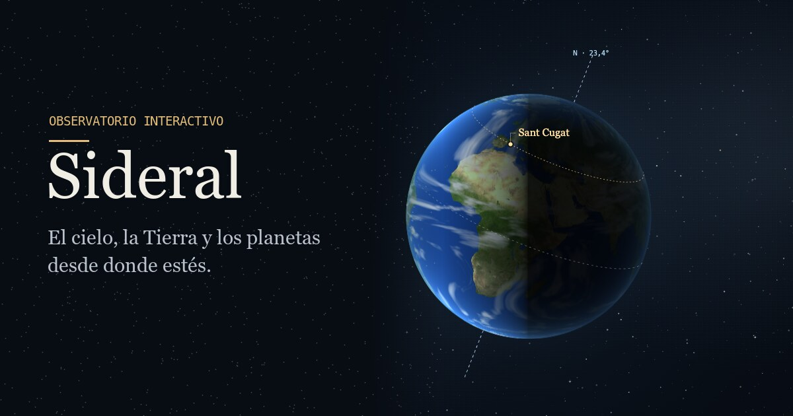
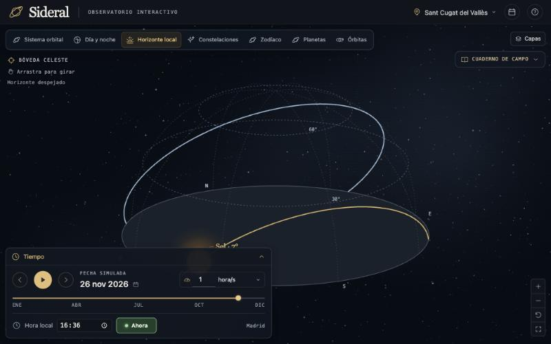
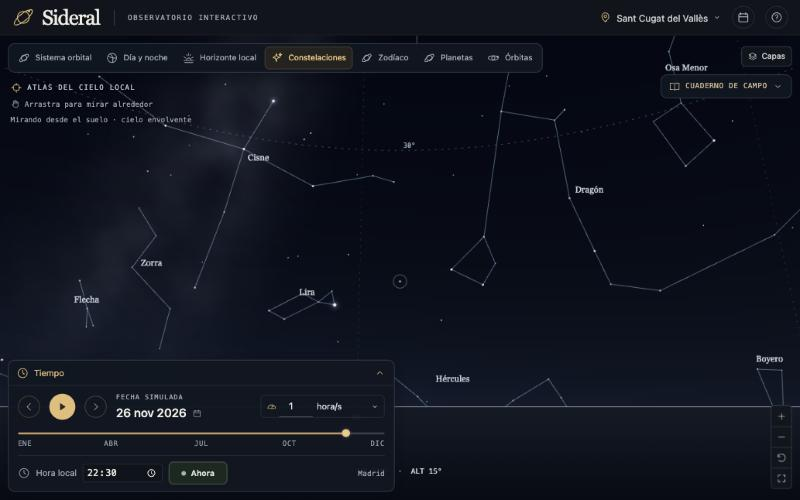
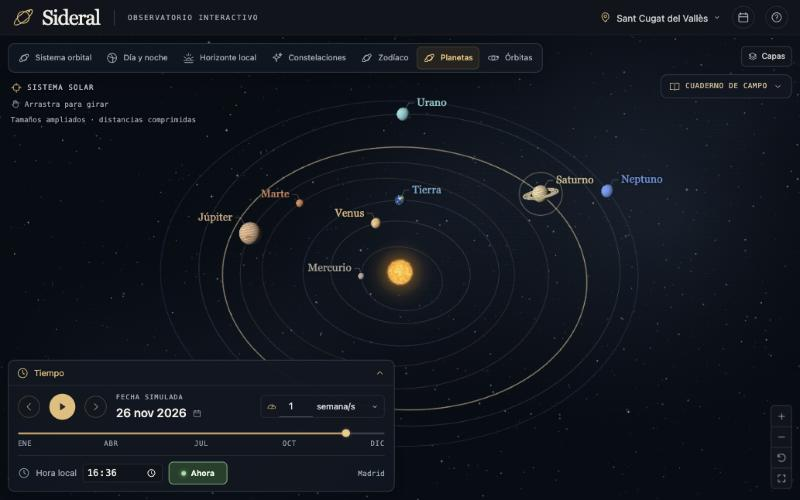
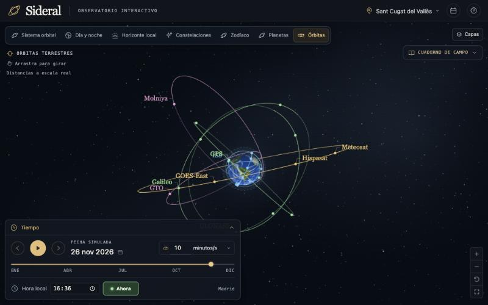

<p align="center">
  <a href="https://hermesvf.github.io/sideral/">
    
  </a>
</p>

<h1 align="center">Sideral</h1>

<p align="center">
  <em>Un observatorio interactivo para entender el cielo:<br>el Sol, la Luna, las estrellas y los planetas, vistos desde donde estés.</em>
</p>

<p align="center">
  <a href="https://hermesvf.github.io/sideral/"><strong>✦ Abrir Sideral ✦</strong></a>
</p>

---

Sideral es una sola página web, sin instalación ni dependencias, que calcula en tu navegador dónde está cada astro en cualquier fecha y hora. Está pensada para **ver** la mecánica celeste: por qué cambian las estaciones, por qué la Luna sale cada día más tarde, qué hace un planeta cuando «retrocede» o por qué el Sol no sale siempre por el este exacto.

## Siete formas de mirar

| | |
|:--|:--|
| 🪐 **Sistema orbital** | La Tierra y la Luna alrededor del Sol, con la inclinación del eje y las estaciones. |
| 🌍 **Día y noche** | La Tierra en 3D con nubes reales, las luces de las ciudades en el lado de noche y tu ciudad marcada. |
| 🌅 **Horizonte local** | La bóveda celeste sobre tu cabeza: el arco del Sol y el de la Luna, sus alturas, y los planetas visibles. |
| ✨ **Constelaciones** | El cielo envolvente desde el suelo, con figuras, la Vía Láctea y una ficha de atlas para cada constelación. |
| ♈ **Zodíaco** | Qué significa que el Sol o la Luna «estén» en una constelación. |
| 🔭 **Planetas** | El sistema solar completo con posiciones calculadas y fichas de cada planeta. |
| 🛰️ **Órbitas** | Órbitas terrestres a escala real: LEO, MEO, GEO, Molniya… con satélites de ejemplo y la ISS. |

<table>
  <tr>
    <td></td>
    <td></td>
  </tr>
  <tr>
    <td></td>
    <td></td>
  </tr>
</table>

## Lo que puedes hacer

- **Viajar en el tiempo.** Avanza o retrocede fotograma a fotograma (teclas <kbd>,</kbd> y <kbd>.</kbd>), elige la velocidad (de minutos a semanas por segundo) o vuelve a **Ahora** con un clic.
- **Cambiar de lugar.** Sant Cugat, Quito, Tromsø… o **Mi ubicación**, que usa tu posición real (redondeada a ~1 km y guardada solo en tu navegador).
- **Leer el cuaderno de campo.** Cada vista explica lo que estás viendo con datos del momento: horas de salida y puesta, altura máxima del Sol, arco de la Luna, fase lunar, solsticios y equinoccios.
- **Comparar arcos.** Superpone el recorrido más alto y más bajo del Sol y de la Luna a lo largo del año en tu horizonte.
- **Activar capas.** Guías de altura, planetas en el cielo, astros bajo el horizonte e ilustraciones de las constelaciones.
- **Usarlo en el móvil.** La interfaz se adapta a pantallas pequeñas y los controles de tiempo quedan siempre a mano.

## Cómo funciona

Todo ocurre en el navegador, sin servidores ni cuentas. Sideral calcula:

- La **posición del Sol** con la ecuación del tiempo y la declinación (ecuaciones solares de NOAA y del USNO).
- La **Luna** con su latitud eclíptica, distancia, fase y el nodo de su órbita, de donde salen sus salidas, puestas y el límite de su declinación (ε + 5,145°·cos Ω).
- Los **planetas** con los elementos orbitales aproximados del JPL y la ecuación de Kepler.
- Las **estrellas** pasando de coordenadas ecuatoriales J2000 a altura y acimut según tu latitud, tu longitud y el tiempo sidéreo.

El dibujo es Canvas 2D puro, sin bibliotecas: proyección en perspectiva de la cúpula, esfera texturizada con muestreo bilineal y deformación afín de las ilustraciones sobre el cielo.

## Ejecutarlo en tu ordenador

Basta un servidor estático en la carpeta del proyecto:

```bash
python3 -m http.server 8765
```

Y abrir <http://localhost:8765/Sideral.html>. Para que funcione **Mi ubicación**, la página tiene que servirse desde `localhost` o `https`.

## Estructura

```
Sideral.html                 La aplicación completa (HTML, CSS y JS en un solo archivo)
index.html                   Redirige a Sideral.html
og-sideral.jpg               Imagen para compartir en redes
ilustraciones-universum/     Ilustraciones de las 88 constelaciones y su alineación con el cielo
docs/                        Capturas para este README
```

## Créditos

- **Ilustraciones de constelaciones:** [Universum](https://universum.lu/en/atlas/constellations/) · Steve Cimolino, con licencia [CC BY-NC 4.0](https://creativecommons.org/licenses/by-nc/4.0/). Redimensionadas a 768 px de lado máximo y recomprimidas para aligerar la web. Detalles en [`ilustraciones-universum/LICENSE.txt`](ilustraciones-universum/LICENSE.txt).
- **Figuras y catálogo de estrellas:** derivados de [d3-celestial](https://github.com/ofrohn/d3-celestial) de Olaf Frohn.
- **Textura de la Tierra:** Blue Marble (día) y Black Marble 2016 (luces nocturnas), NASA Earth Observatory.
- **Nubes:** [Solar System Scope](https://www.solarsystemscope.com/textures/), a partir de datos de la NASA, con licencia [CC BY 4.0](https://creativecommons.org/licenses/by/4.0/).
- **Fronteras y nombres de constelaciones:** [UAI](https://iauarchive.eso.org/public/themes/constellations/).
- **Elementos orbitales de satélites:** [CelesTrak](https://celestrak.org/NORAD/elements/).
- **Fórmulas:** [JPL · posiciones aproximadas de los planetas](https://ssd.jpl.nasa.gov/planets/approx_pos.html), [NOAA · ecuaciones solares](https://gml.noaa.gov/grad/solcalc/solareqns.PDF) y [USNO · posición aproximada del Sol](https://aa.usno.navy.mil/faq/sun_approx).

<p align="center"><sub>Hecho con curiosidad por el cielo · Sant Cugat del Vallès</sub></p>
